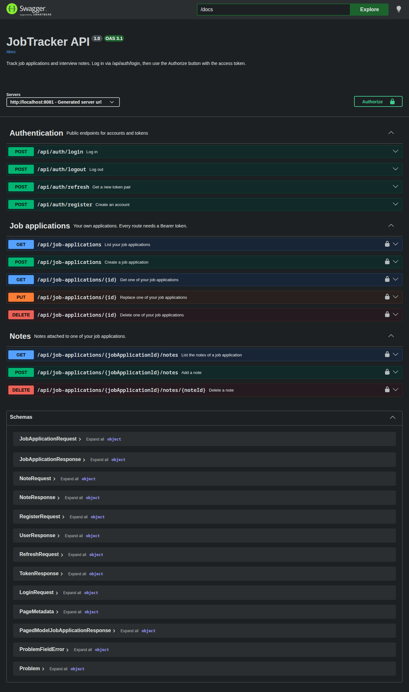

# JobTracker API

[](https://github.com/toshkatta/JobTracker/actions/workflows/ci.yml)



A REST API for tracking job applications: companies, positions, statuses, salaries and interview notes. Each user only ever sees their own data. Built with Java and Spring Boot as a backend portfolio project.

## Features

- **Authentication**: registration and login with BCrypt-hashed passwords, short-lived JWT access tokens and rotating refresh tokens with theft detection (see [Design decisions](#design-decisions))
- **Job applications**: full CRUD with filtering by status, sorting and pagination
- **Notes**: notes attached to each application, with an "important" flag
- **Ownership**: every query is scoped to the logged-in user; another user's data looks like it doesn't exist
- **Validation and errors**: Bean Validation with consistent [RFC 9457](https://www.rfc-editor.org/rfc/rfc9457) `application/problem+json` error responses
- **API documentation**: OpenAPI 3 with an interactive Swagger UI, generated from the code
- **Database migrations** with Flyway, UUIDv7 primary keys
- **Tests**: unit tests plus integration tests against a real PostgreSQL started by Testcontainers
- **Delivery**: GitHub Actions CI, Dependabot updates, and a multi-stage Docker image that runs as a non-root user

## Tech stack

| Area | Technology |
|---|---|
| Language | Java 25 |
| Framework | Spring Boot 4.1 (Web MVC, Data JPA, Validation, Security) |
| Database | PostgreSQL 18, Hibernate, Flyway |
| Auth | Spring Security OAuth2 resource server (JWT, HS256) |
| API docs | springdoc-openapi (OpenAPI 3, Swagger UI) |
| Tests | JUnit 5, Mockito, AssertJ, MockMvc, Testcontainers, JaCoCo |
| Build | Maven (wrapper included) |
| Code style | Spotless (formatting) and Checkstyle (structure), configured in `config/` |
| CI and containers | GitHub Actions, Dependabot, Docker and Docker Compose |

## Getting started

### Option 1: everything in Docker

The only prerequisite is Docker.

```bash
git clone https://github.com/toshkatta/JobTracker.git
cd JobTracker

# 1. configuration: create your own .env and set a real secret
cp .env.example .env
openssl rand -base64 32        # paste the output as JWT_SECRET in .env

# 2. build and start the API and PostgreSQL
docker compose --profile app up --build
```

The API is at http://localhost:8081. The first build takes a few minutes; later ones reuse cached layers. Stop everything with `docker compose --profile app down` (your data stays in the `pgdata` volume; add `-v` to delete it too).

### Option 2: run from source

Prerequisites: JDK 25 and Docker (for the database).

```bash
# same configuration step as above (.env with a real JWT_SECRET)

# start PostgreSQL only (port 5433)
docker compose up -d

# start the API on http://localhost:8081
./mvnw spring-boot:run
```

Flyway creates the schema automatically on startup. The credentials in `docker-compose.yaml` and `application.properties` are for local development only.

### API documentation

Once it's running, interactive API documentation is at http://localhost:8081/swagger-ui.html (the raw OpenAPI document is at `/docs`). Log in via `POST /api/auth/login`, then press **Authorize** and paste the access token.

### Try it

```bash
# register and log in
curl -X POST http://localhost:8081/api/auth/register \
  -H "Content-Type: application/json" \
  -d '{"email":"me@example.com","password":"a-long-password"}'

TOKEN=$(curl -s -X POST http://localhost:8081/api/auth/login \
  -H "Content-Type: application/json" \
  -d '{"email":"me@example.com","password":"a-long-password"}' | jq -r .accessToken)

# create and list job applications
curl -X POST http://localhost:8081/api/job-applications \
  -H "Authorization: Bearer $TOKEN" -H "Content-Type: application/json" \
  -d '{"company":"Acme","position":"Backend Developer","status":"APPLIED","salary":5000}'

curl "http://localhost:8081/api/job-applications?status=APPLIED&sort=salary,desc&size=10" \
  -H "Authorization: Bearer $TOKEN"
```

### Run the tests

```bash
./mvnw test
```

Docker must be running: the integration tests start a throwaway PostgreSQL container and never touch your development database. A coverage report is written to `target/site/jacoco/index.html`.

To run everything CI runs (the tests plus the code-style checks), use `./mvnw verify`. To check or fix formatting on its own: `./mvnw spotless:check` and `./mvnw spotless:apply`.

## API overview

All API routes are under `/api`. Everything except `/auth/*` needs an `Authorization: Bearer <access token>` header. Health checks are public at `/actuator/health`.

The table below is a summary. Swagger UI documents every request, response and error in full.

| Method | Path | Description |
|---|---|---|
| POST | `/auth/register` | Create an account (`409` if the email is taken) |
| POST | `/auth/login` | Returns an access token and a refresh token |
| POST | `/auth/refresh` | Exchanges a refresh token for a new pair |
| POST | `/auth/logout` | Revokes the refresh token's whole family |
| GET | `/job-applications` | List your job applications. Query: `status`, `page`, `size` (max 100), `sort` |
| POST | `/job-applications` | Create an application |
| GET | `/job-applications/{id}` | Get one |
| PUT | `/job-applications/{id}` | Replace one |
| DELETE | `/job-applications/{id}` | Delete one (and its notes) |
| GET | `/job-applications/{id}/notes` | List notes, oldest first |
| POST | `/job-applications/{id}/notes` | Add a note |
| DELETE | `/job-applications/{id}/notes/{noteId}` | Delete a note |

Sortable fields: `id`, `company`, `position`, `status`, `salary`. Statuses: `APPLIED`, `INTERVIEW`, `OFFER`, `REJECTED`.

Validation failures return `400` with the failing fields:

```json
{
  "title": "Validation failed",
  "status": 400,
  "detail": "Request validation failed",
  "instance": "/api/job-applications",
  "errors": [{ "field": "company", "message": "must not be blank" }]
}
```

## Project structure

```
src/main/java/com/todoratanasov/jobtracker
├── config        security, JWT, web and OpenAPI configuration
├── controller    REST controllers and route constants
├── service       business rules and transactions
├── repository    Spring Data JPA repositories
├── entity        JPA entities
├── model         request/response DTOs (annotated for the API docs)
├── error         exceptions and the global exception handler
└── security      helpers for the authenticated user
src/main/resources/db/migration    Flyway migrations
src/test                           unit and integration tests
config/                            shared code-style configuration (formatter, Checkstyle)
.github/                           CI workflow and Dependabot configuration
Dockerfile                         multi-stage build of the API image
docker-compose.yaml                PostgreSQL, and the API under the "app" profile
```

Layered architecture: controllers handle HTTP only, services hold the rules, repositories talk to the database. Entities never leave the service layer; the API returns DTO records.

## Design decisions

- **Ownership returns 404, not 403.** Asking for another user's application is indistinguishable from asking for one that doesn't exist, so ids can't be probed. Every repository query includes the owner.
- **Refresh token rotation with reuse detection.** Refresh tokens are random 256-bit values stored only as SHA-256 hashes. Each is single-use. Presenting an already-used token revokes the whole token family, because it signals theft. Logout revokes the family.
- **Login does not reveal whether an email exists.** Wrong password and unknown email return identical responses, and an unknown email still performs a BCrypt comparison so response times match.
- **Stateless access tokens.** Access tokens live 15 minutes and are validated without a database lookup.
- **UUIDv7 primary keys** are not guessable and, being time-ordered, keep database indexes efficient.
- **Sorting is whitelisted** to the fields of the response DTO, so clients can't sort by arbitrary entity fields.
- **Flyway owns the schema.** Hibernate only validates it (`ddl-auto=validate`).
- **Tests treat the API as a black box.** Integration tests send real requests through the full security filter chain to a real database. Test DTOs are deliberately separate from the production ones, so renaming a JSON field breaks a test.
- **Error responses are documented once.** Shared `problem+json` schemas and responses live in the OpenAPI config and are referenced from every endpoint, so the docs stay consistent.
- **A small, layered container image.** A multi-stage build keeps the compiler and Maven out of the final image, the Spring Boot jar is split into layers so code changes rebuild only the small top layer, and the app runs as a non-root user. No secrets are baked in; the JWT secret is passed at runtime.
- **Profiles.** `prod` is a profile, not a separate build: the same image runs everywhere and behavior is switched with environment variables.

## Known limitations

- No rate limiting. Combined with the `409` on registration, email enumeration is possible. A production system would add rate limiting or an email-verification flow.
- A refresh token used twice at exactly the same moment could succeed twice. Fixing it needs an atomic "revoke if not revoked" update.
- Expired refresh tokens are not cleaned up yet.
- Access tokens cannot be revoked before they expire (at most 15 minutes).
- Security-filter errors (missing or invalid token) return an empty `401` body, not `problem+json`.
- No roles or companies yet; every account is a regular user.
- The OpenAPI document and Swagger UI are enabled in the `prod` profile only when `DOCS_ENABLED=true`, which the public demo sets deliberately.
- The database credentials in `docker-compose.yaml` are local development values and must be replaced in any real deployment.

## Roadmap

- [x] OpenAPI / Swagger UI documentation
- [x] GitHub Actions CI
- [x] Dockerfile and a single-command `docker compose` for the whole stack
- [x] Production profile and health checks (Spring Boot Actuator)
- [ ] Frontend client
- [ ] Companies and roles